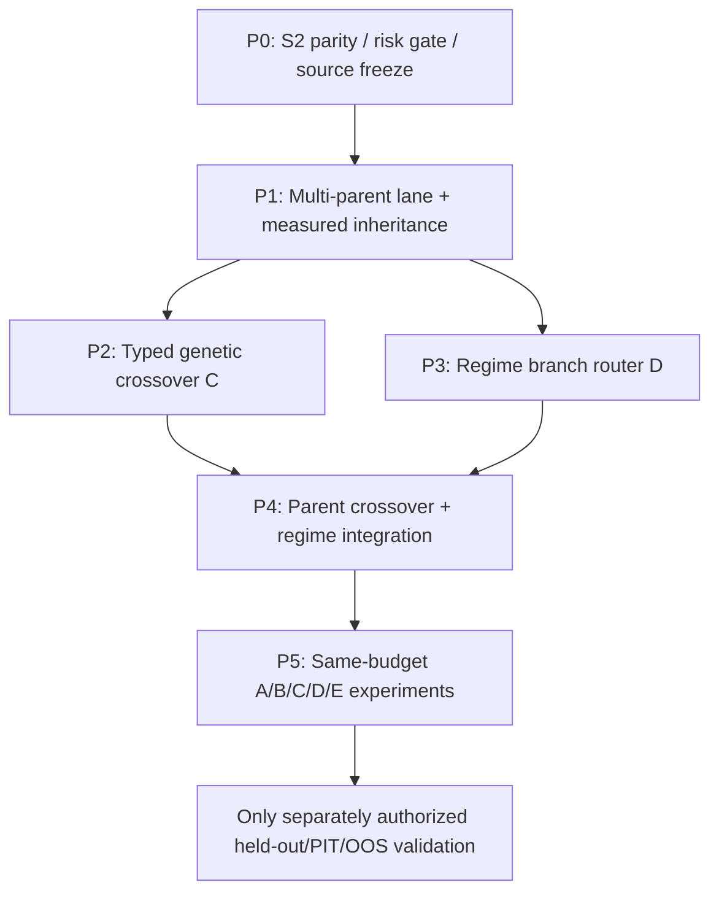

# Quant AutoResearch — 부모 기반 진화 엔진 V3 통합 개선 계획
작성: 2026-10-23 | 상태: **DESIGN ONLY — 미구현·미실험·미배포**

## 0. 개발 목표·불변조건

**목표**: 단일 부모의 고정 변형 반복에서 벗어나 (A) 단일 부모 기준군, (B) 검증된 복수 부모 풀/선택·순환, (C) 2개 이상 부모의 실제 실행 가능한 구조적 교배, (D) 시장 국면별 독립 전략 운용/할당, (E) B+C+D 통합 진화까지 지원한다. GPT는 조건·지표·위험관리·교배 방식·국면 분기·후속 실험을 자유롭게 제안할 수 있다. 매 세대 실측 결과에 따라 부모의 유지/승격/대체/분기를 증거로 결정한다. 단순히 세대 카운터를 늘리는 것이 목표가 아니다.

**절대 보존**: 원본 학술 G452/452, 100세대 비교군 G453–G552 완료 체크포인트와 해시, 별도 GPT-직접 G453, 과거 운영 Quant OAuth/원장, Git 이력/기존 URL 및 Moon 설정 불변. 원본 DB에 직접 스키마 변경·실험 기록 추가 금지. 일단 복제본 전용 feature flag; 실거래·주문 비활성; 기존 인증 MCP 재등록·OAuth 재발급 금지. 미승인 OOS 접근 금지. 승인된 GPT 모델 연결 없이 무인 GPT 10/100 성공 주장 금지. 기본 연구 시장은 단일 QQQ 일봉, 다음날 시가 체결·동일 수수료 및 슬리피지. 다종목 공유자본 운용은 범위 별도.

## 1. 실제 코드 점검 결과 및 실험이 해결해야 할 문제

- `research/llm/parent_portfolio_v2.py`: counted generation 및 S7 child의 다목적 Pareto/세 가지 parent lane 선택·rotation 존재. `application/academic_checkpoint_service.py`는 `parent_portfolio_v2=False` 기본 설정이며, risk budget과 P3 semantic preflight는 V2 활성화를 전제로 한다. 단일 경로에 머물면 구성요소 교배는 작동하지 않는다.
- `strategy_ir/schema.py`: `StrategyIR.parents`, entry/exit/risk/indicator/feature/전체 regime_filters를 표현할 수 있으나 **부모의 각 요소를 누구로부터 상속했는지, 국면별 별도 전략 상태·exit·자본 분배를 나타내는 합성 IR이 없다**. `research/llm/intent_bridge.py`의 `apply_intent`도 실제 적용은 단일 parent StrategyIR 기반이다.
- `core/backtest/p2_policy.py`: RegimeRoute.when/entry/position_size_pct, ATRVolatilitySizing, 4개 제한 regime routes. `core/backtest/engine.py`에서는 **첫 번째 일치 국면의 entry만 판정하고 위치 크기를 조정**한다. 각 route의 독립 exit/risk/strategy lifecycle, 장부/공유자본을 구성한 완전한 multi-strategy router가 아니다. 전략 전환 시 기존 포지션의 처리와 route overlap/unknown 정의가 필요하다.
- 과거 100세대의 부모는 G4 *원본이 아니라* **G4 S7 후속 전략**(+68.22%, MDD20.14%, 71거래) 1개로 고정됐고, 새로운 부모로 재계승되지 않았다. 100개 가운데 MDD30% 초과 82개. 100개 S7 진단 전부 max_drawdown 감소만 예측, 변경 제안은 0.25/0.5의 두 exit 형태; 64개 S7 예측 실패. 50회 `inherited fill has no valid close decision` 감사 오류. 100개 유효 시그널 중 동일 요약 경제 성과 7개 추가 중복; 204 후보 신호중복. 모델 호출 없는 고정 규칙 탐색. 임의로 다시 100회 돌리기보다 이러한 실패 원인 해결 후 설계 차이를 검증한다.

## 2. 아키텍처: 연구 전략 유전자, 부모 풀, 실행 가능한 자식

### 2.1 검증 부모 풀 (Parent Genome Pool)
- **부모 후보 타입**: counted StrategyIR / 정식 S7 child / 검증된 후속 교배 자식 / 국면별 평가 전략. 동일 asset·data/cost 버전에서 replay 가능한 후보만 선택 가능.
- **검증 키**: source_generation + source_evidence_hash + source_report_hash + strategy_ir_hash + effective_signal_hash + data_version + cost_model_version + audit_hash + software_revision.
- **부모 역할**: entry donor, exit donor, risk donor, regime donor, feature donor. 부모 수 1 이상, 실제 교배 초기 지원 2–3개, 시험 통과 후 configurable N 부모(성능·복잡도 budget으로 제한; 하드코딩 '무조건 3개' 아님).
- **다양성 관리**: 수익률, MDD, Calmar, Sharpe, 거래 수, turnover, 노출, 전략 계열, 경제적 결과 fingerprint 및 **실제 체결 신호 간 거리** 사용. 동일 실행 결과/동일 신호 계열은 후보군 집계 시 클러스터링해 중복 부모가 Pareto pool을 점유하지 못하게 한다.
- **동적 계승**: 이전 부모 champion을 무조건 대체하지 않음. 개발 데이터에서 새로운 후보가 다목적 위험·거래 조건을 충족할 때만 승격, 그렇지 않으면 champion 유지 및 다른 family/route 탐색. 탐험 lane과 챔피언 lane은 서로 다른 정책 및 표시. 채택/거절 이유와 상대 metric, evidence hash를 기록.
- **재시작 결정성**: session/next_generation 단위 pinned parent_set; 후보 풀 갱신은 세대 커밋 후 다음 세대에만 적용. 선택 기록은 one-to-many 부모 배열, 역할, 가중치 및 출처별 증명으로 저장.

### 2.2 V3 합성 표현 (CompositeStrategy/Genome V3)
추가 **versioned** envelope로 구현하되 기존 StrategyIR v1 직렬화/해시를 절대 변경하지 않는다:
- `genome_id`, `schema_version=3`, `lineage[{source_id,source_generation,source_evidence_hash,source_report_hash,role,component_hash}]`.
- `entry`, `exit`, `risk`, `feature_graph`, `regime_routes`, `allocation`, `transition_policy`, `research_provenance`. 각 속성은 typed AST/IR, 참조 검증 및 component hash 유지.
- child의 canonical `composite_hash=content_hash(canonical_v3_envelope)`; canonical execution `execution_signal_hash`에는 entry·exit·risk·regime transition·position sizing·fill traces를 반영. 별도 `economic_fingerprint`로 전략을 다른 이름으로 반복 세기 방지.
- 기존 entry/exit RiskConfig와 `P2ResearchPolicy`를 재사용하는 adapter는 명시적으로 v3 규칙을 검증·컴파일하는 방향으로 작성. 선별되지 않은 외부 Python/Pine 코드를 직접 실행하지 않음.

### 2.3 부모 교배 C — 실제 실행 가능한 유전자 재조합
- **구조 교배**: (A.entry + B.exit + C.risk), 또는 (A.entry + B.entry의 AND/OR 조건) + C.exit, 국면별 서로 다른 donor. indicator alias/parameters/feature ref 충돌은 namespaced 해석, 규칙 소실 금지.
- **매개변수 변형**: 기간·임곗값·AND/OR·stop/take-profit/trailing·ATR sizing·feature expression 변경 허용. 동일 원리를 보존하면서 새 구조를 탐색한다.
- **신규 지표/알고리즘**: GPT 제안 허용, FeatureProposal은 quarantined registry 검증(라이선스, 의존 데이터, 무미래참조, 타입, 길이, 재생, 테스트)을 거친 후 정식 feature로 사용할 것. 유효하지 않으면 세대 미집계.
- **부모 조합 충돌**: 정의되지 않은 indicator, 서로 모순된 entry/exit, 순환 참조, noncausal signal, 불가능한 stop, 초과 노출, signal non-execution, 중복 경제 실행 시 reject with reason. 관련 실패는 원장에 별도 proposal attempt로 남기되 검증된 세대로 계산하지 않는다.
- **재조합 실험 설계**: 1회에 변경한 유전자를 식별해 entry 교환 단독, exit 교환 단독, risk 교환 단독, 통합 교배를 각각 동일 부모/비용/자료에서 ablation. 협력/상쇄효과를 로그로 비교.

## 3. D 시장 국면별 다중 전략 운용

### 3.1 Regime Detector / Router
- 국면은 단순 3개 이름에 고정하지 않는다: trend-up, trend-down, range, high-volatility, unknown/cold-start를 기본 등록하고 LLM이 **검증된 선행 조건**으로 세분화 가능. 동시 다중 regime match의 우선순위와 no-match를 명시.
- **실행 입력**: 완료된 t일 봉/당시 이용 가능했던 지표 및 시장 상태만 사용 → 다음 거래일 t+1 시가 주문. t+1 시가나 미래 보정 데이터로 t의 분류를 만들지 않는다. 금융 data alignment, warmup, timezone, revision/lag를 차단.
- first-match deterministic router와 scored/weighted blended router를 둘 다 지원하되 동작 계약 분리. 국면 변화의 경계 떨림은 hysteresis, min dwell bars, confidence threshold, unknown→cash/no new entry default로 처리. 시장 갭이나 특이상황에서 정보 누출 없는 lag를 보존.
- 국면별 **독립 entry + exit + risk + sizing + route state** 지원. 현재 P2 entry/size-only routing을 그대로 '다중 전략 완성'이라 부르지 않는다. 기존 포지션을 강제 청산할지, 이전 route의 exit에 맡길지, 리밸런싱할지를 `transition_policy`로 명시.
- 같은 QQQ에 전략 A/B가 동시에 신호를 보낼 경우 엔진 내부 subposition 장부로 합산하고 netted order에 보수·slippage 1회 적용; fill attribution도 원래 strategy_id로 재매핑. 동일 계정 매수/매도 상쇄, 수량 소수점·반올림, overspending/short 권한 금지.
- **공유자본 예산**: 각 route/strategy 가중치, 총 노출 상한 <=100% 초기 기본, route exposure cap, turnover/cost budget, global drawdown guard; 각 child의 단독 MDD와 통합 포트폴리오 MDD 별도. 자본 분리 없이 독립적으로 각 전략에 100% 부여해 결과를 더하지 않는다.
- **비교 모드**: exclusive selector(국면당 1전략), weighted ensemble(동시 신호 비중 결합), fallback cash/no-trade. 각 모드의 독립 비용 반영 원장과 shared NAV 필요.

### 3.2 최종 통합 C+D
- 상승 국면: 모멘텀/추세 donor 조합; 횡보: 평균회귀/진입 엄격화; 약세/고변동: 낮은 포지션 또는 현금 유지 (연구 예시일 뿐 하드코딩 금지).
- route별로 다른 부모에서 entry/exit/risk를 결합 가능. 한 child Genome은 `parents[...]`와 각 route의 donor lineage를 모두 보유. 전략 교배 이후 국면별 위험 관리가 의미 있게 바뀐 경우만 새로운 composite 전략으로 기록.
- 분석은 각 route 단독 outcome, regime misclassification, 전환 비용, NAV 상대 공헌, 종합 포트폴리오 outcome, QQQ 동일 기간 비교를 함께 저장.

## 4. 실험 실행·증명 파이프라인 (모든 모드 공통)

0. `SOURCE_FREEZE`: dataset hash, PIT/lag, code commit, risk policy, baseline G552 fingerprint, parent pool/evidence 모두 pin.
1. `HYPOTHESIS`: GPT 또는 deterministic baseline 모델/정책 출처를 구분해 한 세대당 후보 제안 및 이전 손실/실패 패턴 링크.
2. `PARENT_VALIDATE`: 부모별 S7/counted source 증거, 독립 replay, donor role, data/feature compatibility.
3. `COMPOSE`: typed v3 child genome을 구성; signal/compiler/feature registry static checks.
4. `S2`: 엔진 실제 체결과 decision trace 1:1 audit; `inherited fill has no valid close decision`은 internal parity fault로 별도 기록 및 fail closed, 정상 실패처럼 전략 수익률 집계 금지.
5. `P3_DEDUP`: strategy semantic, effective signals, fill trace, economic fingerprint를 단계별 비교; 완전히 동일한 결과면 counted 세대 불허, 근접 유사 전략도 클러스터링.
6. `RISK_GATE`: max candidate MDD 30%, parent 대비 추가 MDD <=15pp, 30 closed trades(초기 *연구 적격* 기준), cash exposure/overall NAV checks. 높은 수익이라도 fail이면 불합격 후보로 기록. 실험 자체 기록 vs '인증 통과' 별도.
7. `S7_ABLATION`: 정확한 parent 및 donor 단독/교배 통합/route 없는 버전과 대비, actual costed fills 및 net NAV, execution delta, 4개 development subwindows, 수익/MDD 모두 평가. 예상 지표 방향이 실패하면 다음 가설 제약을 갱신한다. 인과·OOS 성공 주장 금지.
8. `PROMOTE`: champion lane에 한하여 return, MDD, Calmar, turnover, overlap, risk, cost, robustness를 함께 평가, 증거가 나쁘거나 불확실하면 유지; 별도로 실험 다양성 lane 지원. 실패 이유 반드시 기록.
9. `COMMIT`: model proposal provenance + component provenance + run/evidence parent linkage + S7 report hash + parent selection decision을 append-only 체인 저장. interrupt/retry: atomic precommit + immutable receipts, restart idempotent/no phantom generation.
10. `DASHBOARD`: displayed completed generation, tested attempt, risk-qualified, replay-verified, OOS-qualified, GPT-authored를 분리. parent DAG/child crossovers, source regime, NAV/benchmark/exposure/MDD/fees, failed audit cases와 비교군을 표시.

**GPT 출처**: P3 `ModelProposalAudit`는 현행 코멘트 그대로 caller-supplied transport에 대한 자체 영수증일 뿐 암호학적 model provider attestation은 아니다. API 연결/요청 ID/모델 정보/청구/응답 해시를 교차 검증한 경우만 'GPT-authored'로 표기. 임의 모델 결제/키 신설 금지.

## 5. 단계별 개발 순서 및 작업 대상

### Gate P0 — S2 일치성·안전선 회복 (선행 필수)
- 50건 `inherited fill has no valid close decision`를 대표 IR + bar timestamp + decision/fill ID로 축약, parent별 next-open/exit precedence/open position parity 재현.
- 독립 S2 검사와 canonical BacktestEngine의 동작 차이를 수정/테스트, 회귀 fixture 등록. malformed IR fail-closed, 원본 해시 회귀·DB 무결성 통과.
- **합격**: 기존 재현 오류를 엔진/감사 규약으로 설명하고, 유효 실행은 fill/decision 1:1 PASS, invalid inputs는 분류된 오류로 PASS, 원장/주문/OOS 불변.

### Gate P1 — 복수 부모 기반 선택/실제 다음 부모 계승 (B)
- `research/llm/parent_portfolio_v2.py`, `application/academic_checkpoint_service.py` 활용. 보안된 clone만 opt-in V2+P2+P3, 2–3 parent lane의 실제 분화·pinned role/selection hash, S7 child promotion/retention.
- 다른 부모가 **실제** 전략 컴파일/실행에 들어가는지 (metadata 수정만 되는 허위 계승 방지) 거래·해시 검증.
- **합격**: 출처가 다른 부모 2종 이상을 실제 실행하고 원본과 달라지는 fill을 확인; 우수/열등 candidate 채택·거부 양쪽 사례, stop/resume 증거 같음. 적격 후보가 없으면 부모 유지도 정상 판정.
- 첫 mini clone **10세대** (3부모 강제 회전 아님; eligible pool 1개일 땐 정직하게 1개라고 기록).

### Gate P2 — typed Crossover Genome (C)
- 신규 `research/llm/composite_genome.py`(가칭), `research/llm/crossover_engine.py`, `research/indicator_engine/composite_compiler.py`; 기존 IR 스키마 직접 소급 변경 금지.
- 2/3부모 역할 조합·충돌 해결·feature alias lineage·수치/규칙 변형 및 de-dup. 좁은 AST 승인, 유효한 실제 신호와 거래만 세대 커밋.
- **합격**: A.entry+B.exit+C.risk 등 서로 다른 2~3 부모가 각각 실제 체결/위험 행동에 영향을 미치는 것이 ablation 검증에서 확인됨. 동일 부모 변형 baseline 대비 구조적 유효성·재현성 PASS. 10세대 smoke.

### Gate P3 — Stateful regime multi-strategy router (D)
- 기존 `core/backtest/p2_policy.py`/ `core/backtest/engine.py` 재사용 + 새 versioned `regime_strategy_router`, `portfolio_allocator`, `fill_attribution` 모듈을 **기존 single-strategy path를 건드리지 않는 opt-in**으로 추가.
- branch-local exit/risk, hold/sell route transition, regime conflict priority, t→t+1 lag, multi-subposition and shared NAV, no-match and ATR signal missing semantics.
- **합격**: 상승/횡보/하락 및 겹침/미정 국면 테스트에서 올바른 전략 실행/전환/비용/자본 conservation; 1개 종목 공유계좌 100% 초과 사용 불가; 10세대 smoke.

### Gate P4 — C+D combined / research knowledge integration
- 3개 부모와 regime별 strategy donor를 합성한 genome 교차 실험, route 도입 전후 ablation, 사전 정의된 comparator와 risk qualification.
- 기존 deterministic policy vs actual GPT-authored decision policy의 **같은 dataset/cost/parent source/budget** A/B를 운영 검증. 동일 provenance가 없는 arm 간 데이터 혼합 금지.
- **합격**: 부모×route 계보 감사, shared NAV 일치, 실패 가설 → 다음 가설 변경이 실제 기록으로 관찰되며, 단지 매번 규칙을 고정 순서로 바꾸는 컨트롤러가 아님을 증명.

### Gate P5 — 비교 연구/승격 판정
동일 개발 데이터와 수수료/기간/초기현금, 동일 목표 generation/후보 budget에서:
- **A** fixed 1-parent + deterministic baseline
- **B** multi-parent selection + conditional inheritance
- **C** B + structural crossover
- **D** B + regime-specific independent strategies/allocation
- **E** B + C + D integrated
- 각 arm **사전 통합 10세대**, 성공한 arm만 **30~50세대 확장**, 이후 **100세대** 비교. 비용 많이 드는 LLM 실행은 permissioned connector를 통해 별도로 승인된 quota와 receipts 전제. 비표준 시드/parent pool/시기 차이는 결과에 명시.
- 평가: 평균이 아닌 **best risk-qualified champion과 개별 valid-rate, Calmar, QQQ excess, MDD, volatility, trade count, exposure, transaction costs, discovery efficiency (eligible/new experiment), unique trade fingerprint, parent promotion rate, route attribution, model latency/token cost**. across arms bootstrap 및 walk-forward 개발 내부 분할은 exploratory only.
- **주요 성공 기준**: (a) 완주와 evidence 100% (b) 안전성 hard gate 및 0 실거래 (c) 적어도 하나의 비baseline 방식이 같은 비교 시점에서 risk-qualified champion을 개선 (d) 다양성/부모/branch 효과 replay로 입증 (e) model provenance verified. 데이터로 확인되지 않으면 '개선 실패' 판정, 유망한 결과는 champion 후보만 유지.
- **OOS는 후속 별도 승인 게이트**: 이미 수백 번 재사용한 2020–2025 QQQ는 신규 OOS로 위장 금지. 별도 forward/PIT/봉인 데이터 보존·거래비용 stress 후만 실전성 평가, 실거래 OFF.

## 6. 적용 순서 (의존성)

## 7. 작업 완료 정의 (Definition of Done)
- 단일 부모 고정 100세대 카운팅 ≠ V3 완료. 자식마다 다중 source provenance, 정확한 component donor 및 실제 변형된 fill/risk 결과가 필요.
- 모든 세대/후보는 `proposal → typed compile → S2/fills → risk → S7 → parent promotion/retention → commit`의 근거가 연결돼야 함. 실패·재실행도 계보 보존.
- 구 API/StrategyIR v1/기존 G552 DB 해시 재생 PASS, 실제 코드 변경 후 테스트/commit/PR 등 별도 리뷰, 지정된 고정 URL/OAuth 보호. No hidden trading order/OOS.
- Dashboard에는 결과 전략별 고유 식별자, 수익/MDD/QQQ 비교, 진짜 GPT 여부와 별도 리스크 통과 상태 및 원본 연구 범위를 분리.
- 비용 및 구현 범위가 커지면 P2/P3을 독립 모듈로 분리 구현하되 P0/P1 검증 없이 '복수 부모 교배 완료'를 주장하지 않을 것.

**현재 문서는 계획서이며 구현·실험·배포 성공을 의미하지 않는다.**
